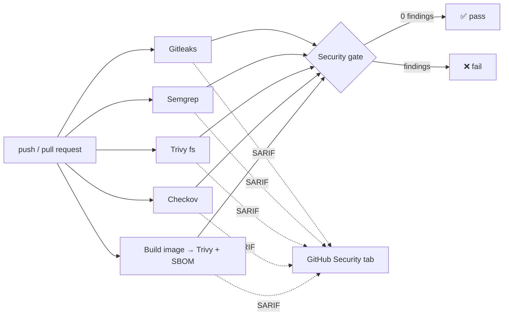

# secure-ci-kit

[](https://github.com/Kemalstudio/secure-ci-kit/actions/workflows/self-test.yml)
[](LICENSE)

A reusable GitHub Actions workflow that adds a **DevSecOps security gate** to any repository with a few lines of YAML.

It checks your code for leaked secrets, insecure code, vulnerable dependencies, misconfigured Dockerfiles and IaC, and vulnerable container images. It also generates an SBOM. Results appear in the GitHub **Security tab**, as a summary table on every run, and as downloadable reports.

```yaml
jobs:
  security:
    uses: Kemalstudio/secure-ci-kit/.github/workflows/scan.yml@v0.1.0
    permissions:
      contents: read
      actions: read
      security-events: write
```

## What it checks

| Check | Tool | Finds |
| :--- | :--- | :--- |
| Secrets | [Gitleaks](https://github.com/gitleaks/gitleaks) | Passwords, API keys and tokens in files and git history |
| Code (SAST) | [Semgrep](https://github.com/semgrep/semgrep) | SQL injection, command injection, XSS, unsafe deserialization |
| Dependencies (SCA) | [Trivy](https://github.com/aquasecurity/trivy) | Libraries with known CVEs |
| Dockerfile & IaC | [Checkov](https://github.com/bridgecrewio/checkov) | Root containers, privileged pods, Terraform misconfigurations |
| Container image | Trivy | CVEs in OS packages and libraries inside the built image |
| SBOM | Trivy | A CycloneDX list of everything inside the image |

## How it works



- All scanners run **in parallel**, each in its own job.
- Scanner jobs only **count** findings. The final **gate** job adds them up, writes the summary and decides pass/fail. You see every problem at once, not just the first scanner that failed.
- If a scanner crashes, the gate fails. **A broken scanner must never look like a clean result.**

## Proof that it works: the self-test

The repository tests the kit on itself in **both directions** on every push and every Monday:

| Example | Expectation |
| :--- | :--- |
| [`examples/vulnerable-app`](examples/vulnerable-app) | Flask app with one classic bug per endpoint. **Every** scanner must report findings, or the test fails. |
| [`examples/secure-app`](examples/secure-app) | The same app with every bug fixed. The full gate must pass with **zero** findings. |

The first direction proves the scanners catch real bugs. The second proves the rules are not so noisy that nobody can pass them. The weekly run catches CVEs published after the last commit.

<!-- Fill in from the job summary of the first green self-test run. -->
| Scanner | vulnerable-app | secure-app |
| :--- | ---: | ---: |
| Secrets (Gitleaks) | _TBD_ | 0 |
| Code (Semgrep) | _TBD_ | 0 |
| Dependencies (Trivy) | _TBD_ | 0 |
| Dockerfile & IaC (Checkov) | _TBD_ | 0 |
| Container image (Trivy) | _TBD_ | 0 |

## Usage

### Basic: scan the whole repository

```yaml
# .github/workflows/security.yml
name: Security

on:
  push:
    branches: [main]
  pull_request:

jobs:
  security:
    uses: Kemalstudio/secure-ci-kit/.github/workflows/scan.yml@v0.1.0
    permissions:
      contents: read
      actions: read
      security-events: write
```

### With a container image

```yaml
jobs:
  security:
    uses: Kemalstudio/secure-ci-kit/.github/workflows/scan.yml@v0.1.0
    permissions:
      contents: read
      actions: read
      security-events: write
    with:
      dockerfile: Dockerfile
      severity: CRITICAL,HIGH,MEDIUM
```

### Report only, never block

Useful when you add the kit to an existing project with many findings:

```yaml
    with:
      fail-on-findings: false
```

### Inputs

| Input | Default | Description |
| :--- | :--- | :--- |
| `path` | `.` | Directory to scan |
| `name` | `scan` | Name used in artifacts and SARIF categories. Must be unique per run if you call the kit more than once |
| `dockerfile` | _(empty)_ | Build and scan this Dockerfile. Image scanning is skipped when empty |
| `docker-context` | Dockerfile's directory | Docker build context |
| `severity` | `CRITICAL,HIGH` | Trivy severities that count as findings |
| `ignore-unfixed` | `true` | Ignore CVEs that have no fix yet |
| `semgrep-config` | `p/default` | Semgrep ruleset(s), space-separated |
| `scan-git-history` | `true` | Scan all of git history for secrets, not only current files |
| `skip` | _(empty)_ | Scanners to skip: `secrets,sast,deps,iac` |
| `fail-on-findings` | `true` | Fail the run when anything is found |
| `upload-sarif` | `true` | Upload to the Security tab (private repos need GitHub Advanced Security) |

### Outputs

`secrets`, `sast`, `deps`, `iac`, `image`: finding count per scanner. `total`: sum of all.

```yaml
  notify:
    needs: security
    if: needs.security.outputs.total != '0'
    runs-on: ubuntu-latest
    steps:
      - run: echo "Found ${{ needs.security.outputs.total }} issues"
```

## The kit follows its own advice

A security tool that runs in your CI has access to your code, so it should be held to a higher standard:

- **Actions pinned by commit SHA**, scanner images pinned by **digest**. A moved tag cannot change what runs.
- **Least-privilege permissions** per job. The gate job has no token permissions at all.
- **No Docker socket** in scanner containers. The image is exported with `docker save` and scanned as a file, and scanners run as the runner user, not root.
- **No expression injection.** Inputs reach shell scripts only through environment variables, never through `${{ }}` inside `run:`.
- `persist-credentials: false` on every checkout, so scanners never see the git token.
- Every workflow is linted with [actionlint](https://github.com/rhysd/actionlint) and shellcheck in CI.

## Run the scanners locally

The same tools work on your machine with Docker:

```bash
docker run --rm -v "$PWD:/src" -w /src zricethezav/gitleaks:v8.30.1 dir .
docker run --rm -v "$PWD:/src" -w /src semgrep/semgrep:1.181.0 semgrep scan --config p/default .
docker run --rm -v "$PWD:/src" -w /src aquasec/trivy:0.76.0 fs --severity CRITICAL,HIGH .
docker run --rm -v "$PWD:/src" -w /src bridgecrew/checkov:3.3.30 -d . --quiet --compact
```

## Roadmap

- [ ] **DAST:** run the built image and scan it with OWASP ZAP
- [ ] **Image signing:** sign images and attach the SBOM as an attestation with Cosign
- [ ] Pull request comment with the summary table
- [ ] Cache the Trivy vulnerability database between jobs
- [ ] `--require-hashes` for pip in the secure example

## License

[MIT](LICENSE)
